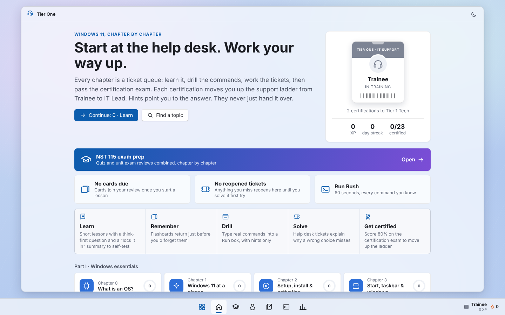
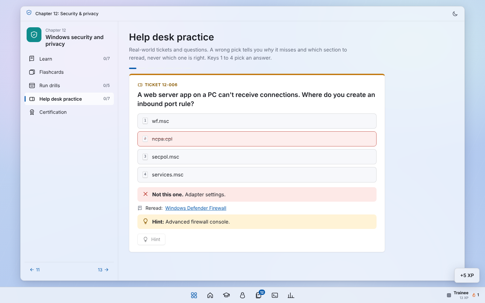
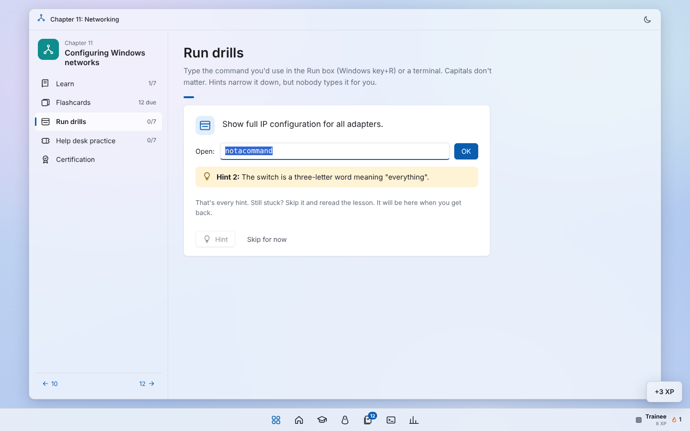
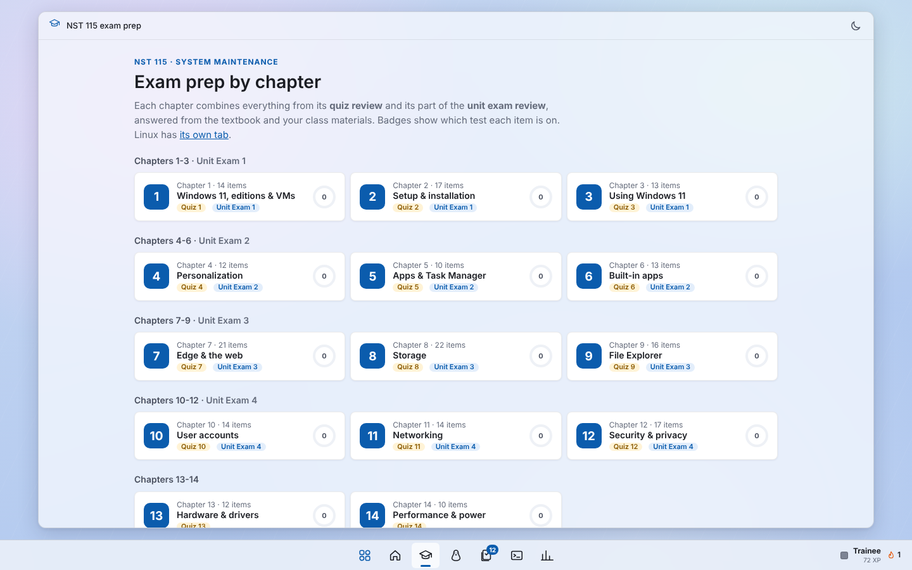
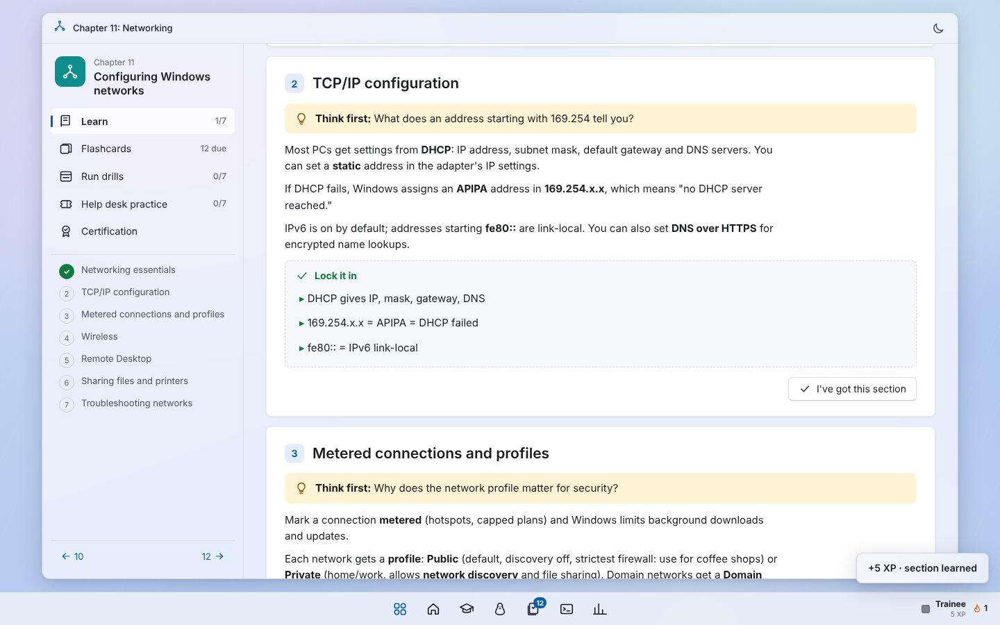
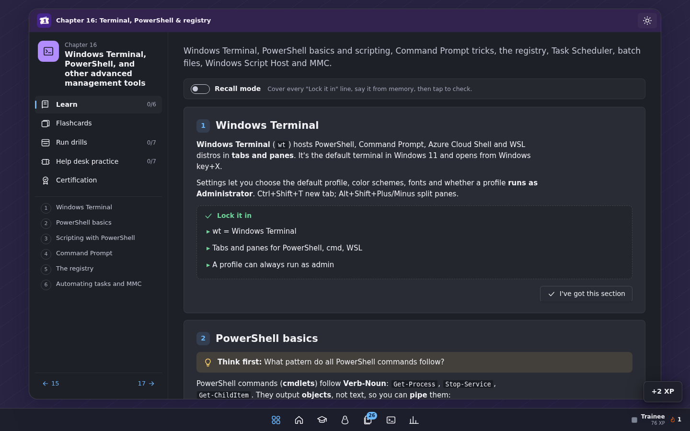
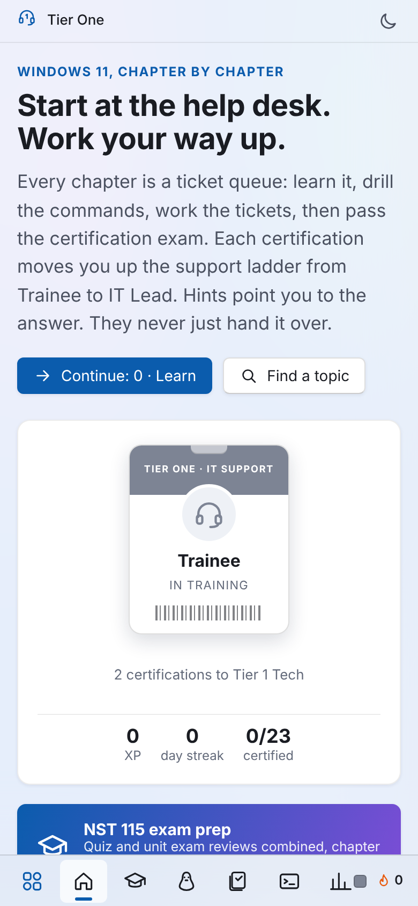
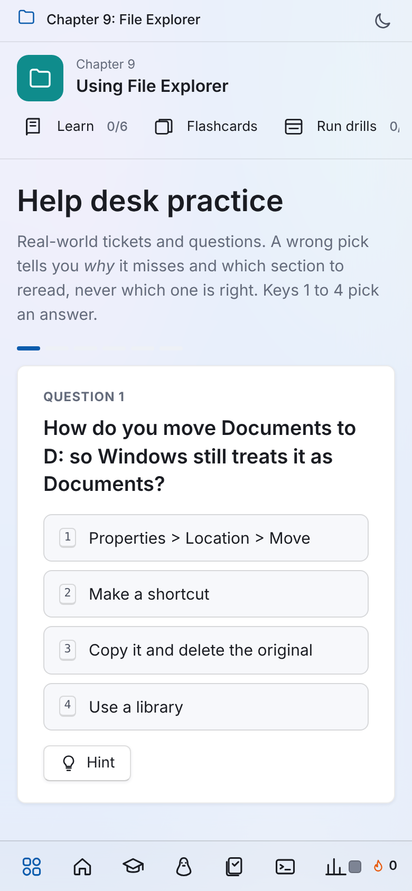

# Tier One

**Windows 11 help desk training, chapter by chapter. Start at Tier 1 and work your way up. Hints point the way, but you find every answer yourself.**

Tier One turns all 19 chapters and 3 appendixes of *Windows 11 Inside Out* into a training course built like a Windows 11 desktop. You start as a **Trainee** at the help desk. Each chapter is a ticket queue with short lessons, spaced-repetition flashcards, Run-box command drills, help desk tickets and a certification exam. Pass a chapter's exam to get certified in it, and every certification moves you up the support career ladder:

**Trainee → Tier 1 Tech → Tier 1 Lead → Tier 2 Tech → Tier 2 Lead → Tier 3 Engineer → Systems Admin → Senior Sysadmin → IT Lead**

Your current rank shows on a technician ID badge on the home screen.

### ▶ [Train here](https://christianjkrantz.github.io/tier-one/)

Works in any modern browser on desktop, tablet or phone. No install, no account, no tracking. It also works offline once it's loaded.



---

## What's inside

| Part | Chapters |
|---|---|
| **I · Windows essentials** | 0 What is an OS? · 1 Windows 11 at a glance · 2 Setup, install & activation · 3 Start, taskbar & windows · 4 Personalization · 5 Apps & Task Manager · 6 Built-in apps · 7 Microsoft Edge · 8 Disks & OneDrive |
| **II · Managing Windows 11** | 9 File Explorer · 10 Accounts & sign-in · 11 Networking · 12 Security & privacy · 13 Hardware & drivers · 14 Performance & power · 15 Troubleshoot & recover |
| **III · For IT pros** | 16 Terminal, PowerShell & registry · 17 Virtual machines · 18 Android & Linux · 19 Enterprise management |
| **IV · Appendixes** | A Editions & licensing · B Windows Insider · C Help & support |

Plus a **Chapter 0** (what an operating system is) from the class slides. That adds up to **123 lessons**, **244 flashcards**, **78 command drills** and **132 questions and help desk tickets**.

---

## No answers handed out

Every study mode follows one rule: **the site never shows you the right answer.** It tells you why a choice misses, gives you a hint, and links you back to the lesson.

| Mode | How it works |
|---|---|
| **Learn** | Short lessons that start with a *Think first* question, flag a *Common trap*, and finish with a *Lock it in* summary. Turn on **Recall mode** to cover the summary and test yourself line by line. |
| **Flashcards** | Say your answer, flip the card, then rate yourself. **Forgot** brings the card back this session, **Shaky** brings it back tomorrow, and **Knew it** moves it up a box (1, 3, 7, 14, 30 and then 60 days). |
| **Run drills** | A Run dialog asks for the tool or command, such as `devmgmt.msc`, `ipconfig /flushdns` or `Get-Service`. A wrong entry gets "Windows can't find…". Two hints narrow it down without spelling it out, and **Skip** moves the drill to the back of the line. |
| **Help desk practice** | Ticket-style scenarios. A wrong pick is crossed out with the reason it misses and a link to the section to reread. The right option is only marked once *you* pick it. |
| **Certification exam** | Every question plus up to three typed commands, with no hints. Score 80% to get certified and move toward your next promotion. The results list your misses, each with a hint and the section to reread, but not the answer. |





### NST 115 exam prep tab
A separate tab (graduation-cap icon on the taskbar) built from the NST 115 review sheets, **organized by chapter only**:
- **Chapters 1-14**: each chapter combines its quiz review (Quizzes 1-14) and its part of the unit exam review (Unit Exams 1-4). Every item is answered from the textbook and class materials, with badges showing which test it's on (**Quiz 8**, **Unit Exam 3**) and a source tag (book chapter, class materials, or general knowledge to check against notes)
- **Review sheet** with Recall mode (answers hidden until you've said them), **Flash review**, and a **Practice exam** that tells you what a wrong pick actually is but never reveals the right one

### Linux tab
The Linux unit has its own tab (penguin icon): Days 1-3 (what Linux is, permissions, scripting), the top 25 commands, **Terminal drills** (case-sensitive, hints only) and an endless **Permissions trainer** (rwx ⇄ chmod numbers).



### Review, Run Rush and progress
- **Review** collects due flashcards from every chapter, plus **Reopened tickets**: every question you've missed reopens until you solve it on the first try.
- **Run Rush** gives you 60 seconds to type as many commands as you can from the whole course. Commands you skip become a list of chapters to drill, not a list of answers.
- **Progress** shows your career ladder, XP, day streak and a chapter-by-chapter table. You can export your progress to a file and import it on another device.
- **Start menu** (Ctrl+K) searches every lesson by topic, tool or command.





<p>


</p>

---

## About the content

The lessons are original study notes. They follow the chapter and section outline of ***Windows 11 Inside Out*** by Ed Bott (Microsoft Press, 2023), which covers version 22H2. Use them alongside the book, not instead of it. No text from the book is reproduced. A few notes cover changes since the book came out, such as the end of Windows Subsystem for Android and the move from Mail and Calendar to the new Outlook.

Tier One isn't affiliated with Microsoft or Pearson. Windows, Microsoft Edge, PowerShell and other product names are trademarks of their owners.

---

## Run it locally

No build step. Clone the repo and serve the folder:

```bash
python3 tests/serve.py        # http://127.0.0.1:8765
```

### Tests

```bash
node tests/test_course.js     # every review-sheet item is complete; definitions don't give away exam answers
node tests/test_content.js    # every question has a valid answer, a reason for each wrong option and a hint;
                              # no hint or reason gives the answer away
python3 tests/test_ui.py      # headless Chromium walk-through of every mode, phone layout, dark mode,
                              # CSP and console errors (add --shots to refresh the screenshots in docs/)
```

### Project layout

```
index.html            app shell: window, taskbar, Start menu
css/style.css         all styles (light and dark, system fonts only)
js/data.js            content loader and validation
js/content-1..3.js    chapter content: Part I, Part II, Parts III-IV
js/course.js          NST 115 exam prep: review-sheet answers, decks, terminal drills
js/icons.js           line icons
js/app.js             routing, progress, and every study mode
sw.js                 offline cache
tests/                content and browser tests, local server
```

Adding or fixing content only means editing a `js/content-*.js` file. The format is documented at the top of `content-1.js`.

## License

MIT © 2026 Christian Krantz
